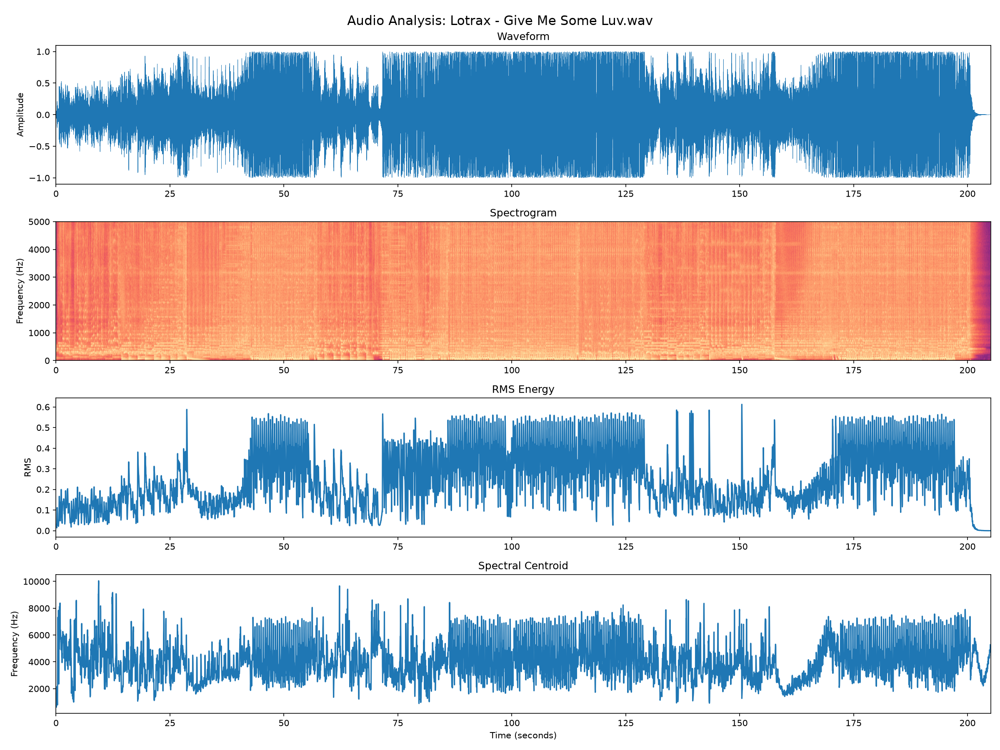

# AI Music Detector

## Audio DSP & Machine Learning Research Project

A Python-based audio analysis and machine-learning research project exploring whether digital signal processing (DSP) features can help distinguish human-produced music from AI-generated music.

## Project Status

**Active development — Initial machine-learning classifier operational.**

The project now includes an end-to-end audio analysis and classification pipeline, from WAV loading and DSP feature extraction to model training, evaluation and prediction on previously unseen recordings.

An initial K-Nearest Neighbours (KNN) classifier has been trained using a small, balanced dataset of five human-produced tracks and five AI-generated tracks.

The first evaluation correctly classified all four held-out tracks (100% accuracy on this specific test). An additional human-produced track from another producer was also classified correctly.

These results are preliminary and do not establish general AI-detection accuracy.

## Project Overview

This project combines my background in Audio Technology and music production with Python programming, DSP and machine learning.

The initial objective is to classify complete human-produced and AI-generated recordings.

The longer-term goal is to investigate the detection of AI-generated vocals and instruments within otherwise human-produced music.

## Implemented Functionality

### Audio DSP

- WAV audio loading, PCM normalisation and stereo-to-mono conversion
- Frame-based FFT analysis with Hann windowing
- RMS energy and zero-crossing rate
- Spectral centroid, spectral rolloff and peak frequency
- 13 Mel-frequency cepstral coefficients (MFCCs)
- 18-dimensional audio feature vectors
- Track-level feature aggregation

### Machine Learning

- Labelled dataset containing five human-produced and five AI-generated tracks
- K-Nearest Neighbours (KNN) classifier using scikit-learn
- Feature standardisation using StandardScaler
- Machine-learning Pipeline combining scaling and classification
- Stratified training/testing split
- Accuracy evaluation and confusion matrix
- Prediction on previously unseen WAV recordings

### Visualisation and Testing

- Four-panel audio analysis dashboard
- Waveform, spectrogram, RMS energy and spectral centroid visualisations
- Command-line interface for analysing WAV recordings
- Automated DSP tests using pytest

## Initial Experimental Results

**Dataset:** 10 recordings (5 human-produced, 5 AI-generated)

**Feature representation:** 18 DSP features per recording

**Training set:** 6 recordings

**Test set:** 4 recordings

**Classifier:** K-Nearest Neighbours (k=3)

**Initial test accuracy:** 100% (4/4 correct predictions)

Confusion matrix:

    [[2 0]
     [0 2]]

An additional previously unseen human-produced recording from a different producer was correctly classified as human.

**Important:** These results are from a very small dataset. They should be interpreted as a proof of concept rather than evidence of reliable or generalisable AI-music detection.

## Audio Analysis Dashboard

The visualiser generates four plots:

- Waveform
- Spectrogram
- RMS energy
- Spectral centroid



## Technology

- Python
- NumPy
- SciPy
- Matplotlib
- scikit-learn
- pytest
- Git and GitHub

## Installation

Clone the repository and install the dependencies:

```bash
git clone https://github.com/LukeSecDunn/ai-music-detector.git
cd ai-music-detector
python -m pip install -r requirements.txt
```

## Usage

### Audio Visualisation

Run the audio dashboard on a WAV recording:

```bash
python audio_visualiser.py "your_track.wav"
```

### DSP Tests

Run the automated tests:

```bash
python -m pytest -v test_audio_analyser.py
```

### Experimental Classifier

The classification experiment is implemented in:

`ai_music_detector.py`

The current script uses locally configured WAV filenames and requires the corresponding audio files to be available.

Audio recordings are not distributed with this repository. Users wishing to reproduce the experiment must supply appropriately licensed recordings and configure the dataset paths.

## Research Methodology

Each recording is processed using a consistent DSP feature-extraction pipeline.

Audio features are aggregated into an 18-dimensional representation for each recording.

The dataset is divided into training and testing subsets using a stratified split.

Feature scaling and classification are implemented using a scikit-learn Pipeline, ensuring that the scaler is fitted using training data only.

The initial classifier uses K-Nearest Neighbours with three neighbours.

Future experiments will investigate larger datasets, additional classification methods and more rigorous validation.

## Dataset Limitations and Licensing

The initial dataset is small and contains human-produced recordings from one producer and AI-generated recordings from one AI music-generation platform.

Potential confounding factors include:

- Musical genre and arrangement
- Mixing and mastering characteristics
- Recording duration
- Audio compression and encoding
- Producer identity
- AI generator identity

Consequently, the classifier may learn differences associated with particular production sources rather than characteristics of AI generation itself.

Future evaluation will incorporate recordings from additional human producers and AI generation systems.

Related recordings and alternate versions must remain within the same dataset partition to reduce data leakage.

Audio files are excluded from the public repository. Dataset sources require documented provenance and appropriate permission for the intended research use.

Download or commercial-use rights do not automatically grant unrestricted machine-learning training or redistribution rights.

## Roadmap

- [x] DSP feature extraction
- [x] Audio analysis dashboard
- [x] Automated DSP tests
- [x] Command-line interface
- [x] Initial labelled dataset
- [x] Train first baseline classifier
- [x] Evaluate initial classifier
- [x] Test prediction on an unseen recording
- [ ] Expand dataset to additional human producers
- [ ] Incorporate additional AI music generators
- [ ] Establish a fixed, independent evaluation dataset
- [ ] Compare alternative machine-learning classifiers
- [ ] Investigate partially AI-generated music

## About

Developed as a personal, non-commercial research portfolio project to demonstrate practical audio DSP, Python programming, software development and machine-learning skills.

The project is under active development, with an emphasis on reproducible experiments, transparent evaluation and continued technical improvement.